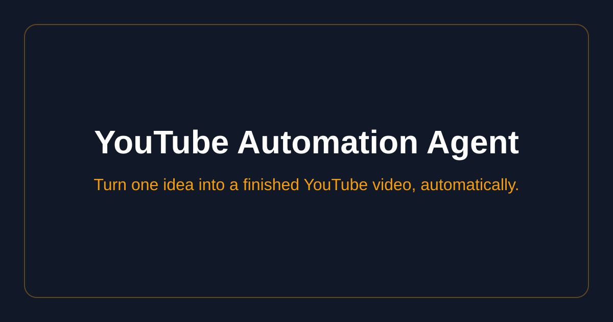

# 🎬 AI YouTube Automation Agent

[](https://github.com/mrabr381/Youtube-Automation-Agent/actions/workflows/ci.yml)
[](https://www.python.org/downloads/)
[](https://opensource.org/licenses/MIT)

Turn one idea into a finished YouTube video, automatically.

An end-to-end, 100% free, fully autonomous YouTube content generation and daily publishing engine. Powered by Google Gemini AI, Pollinations.ai (free image API), Edge-TTS, and FFmpeg.

🌐 **Web dashboard:** [https://youtube-automation-agent-1.streamlit.app/](https://youtube-automation-agent-1.streamlit.app/) — note, checked 2026-11-20: this link currently redirects to a Streamlit login page, so it is not publicly viewable. Deploy your own copy with the steps below if it asks you to log in.

## ✨ Features

- **🔍 Automated topic discovery:** Google Gemini AI analyzes your niche daily and selects viral, high-CTR topics.
- **✍️ Long-form scriptwriting:** 1500–1600 word scripts divided into 75 short visual scenes.
- **🎙️ Studio-quality voice-overs:** natural male & female narration using Google AI Studio (Gemini 2.0 Flash Audio) and Microsoft Edge Neural TTS.
- **🎨 High-definition 1080p visuals:** anime graphic novel / dark webtoon / cinematic artwork using the free Pollinations.ai image API.
- **🎞️ Dynamic video assembly:** direct streaming FFmpeg engine with Ken Burns pan/zoom animations and seamless transitions.
- **📈 Complete SEO optimization:** click-worthy titles, full descriptions with chapter timestamps, search tags, and hashtags.
- **🚀 Automated YouTube upload:** uploads scheduled videos directly to your channel (Public, Unlisted, Private).
- **⏰ Set-and-forget scheduler:** background daily automation running autonomously at your specified time.
- **💻 Clean Streamlit web UI:** dashboard to customize styles, select voices, manage keys, and track live generation logs.

## 🛠️ Zero-cost tech stack

| Module | Engine / Tool | Pricing |
| :--- | :--- | :--- |
| **Topic & Script Engine** | Google Gemini API (AI Studio) | **Free Tier** |
| **Voice-Over (TTS)** | Google AI Studio Audio & Edge-TTS | **100% Free** |
| **Visual Art Generation** | Pollinations.ai image API | **100% Free** (rate-limited) |
| **Video Processing** | Python + FFmpeg Streaming Engine | **100% Free** (Ultra-Low RAM) |
| **YouTube Publishing** | YouTube Data API v3 (OAuth2) | **100% Free** (10,000 daily quota units) |
| **Web Dashboard** | Streamlit Community Cloud | **100% Free** |

## 📋 Prerequisites

1. **Python 3.8 or higher** and **Git**.
2. **FFmpeg** (required for video assembly and Ken Burns animation):
   - macOS: `brew install ffmpeg`
   - Ubuntu / Debian: `sudo apt update && sudo apt install -y ffmpeg`
   - Windows: download FFmpeg from [gyan.dev](https://www.gyan.dev/ffmpeg/builds/), extract it, and add the `bin` folder to your System PATH.
3. **Google Gemini API key** — get a free key from [Google AI Studio](https://aistudio.google.com/).

## 🚀 Installation & setup

### 1. Clone the repository

```bash
git clone https://github.com/mrabr381/Youtube-Automation-Agent.git
cd Youtube-Automation-Agent
```

### 2. Create and activate a virtual environment

```bash
python3 -m venv venv
source venv/bin/activate
# On Windows: venv\Scripts\activate
```

### 3. Install dependencies

```bash
python3 -m pip install --upgrade pip
pip install -r requirements.txt
```

### 4. Configure environment variables

```bash
cp .env.example .env   # On Windows: copy .env.example .env
```

Open `.env` and set at least:

```env
# Gemini API key (free from https://aistudio.google.com/)
GEMINI_API_KEY=your_gemini_api_key_here

# Channel niche & topic domain
CHANNEL_NICHE=AITA Stories & Drama

# Voice-over selection (options: Female_US_Engaging, Male_US_Deep, Male, Female, Male_UK, Female_UK, Male_Urdu, Female_Urdu)
VOICE_GENDER=Female_US_Engaging

# Visual art style modifier
IMAGE_STYLE=detailed 2D anime graphic novel illustration, modern webtoon aesthetic, sharp inked line art, cinematic moody lighting, dramatic shadows, muted color palette, highly detailed background environment, serious tone, 8k resolution

# Target scenes & schedule time
IMAGES_PER_VIDEO=40
SCHEDULE_TIME=10:00
AUTO_RUN_ENABLED=true
YOUTUBE_PRIVACY_STATUS=public
```

### 5. 🔐 One-time YouTube channel authorization

1. In the [Google Cloud Console](https://console.cloud.google.com/), create a project (e.g. `YouTube-Automation-Bot`), enable **YouTube Data API v3** under **APIs & Services > Library**, then go to **APIs & Services > Credentials > Create Credentials > OAuth Client ID**, choose **Desktop App**, name it `YouTube Uploader`, download the JSON, rename it to `client_secret.json`, and place it in the project root.
2. Run `python get_youtube_token.py` — your browser opens Google login; select the account that owns the target channel, click **Continue / Allow**, and the script saves a `token.json` file in the project directory.
3. In the Streamlit dashboard, open the **⚙️ Settings & Configuration** tab and upload your `token.json` (or paste its content) and click **Save Token**. The channel is now authenticated with automated background token refresh.

### 6. 💻 Running the web dashboard

```bash
streamlit run app.py
```

Then open http://localhost:8501 in your browser.

- **🚀 Control Panel:** click **"Generate & Publish Video Now"** for instant on-demand video creation with real-time progress and built-in video preview.
- **⚙️ Settings & Configuration:** update your Gemini API key, change art styles, switch voices, modify schedules, and connect your YouTube token.
- **📜 History & Logs:** records of past automated runs, generated scripts, titles, and direct YouTube video URLs.

## 📁 Project structure

```text
├── app.py                     # Streamlit dashboard (password protected)
├── config.py                  # Environment & settings
├── get_youtube_token.py       # One-time YouTube OAuth token generator
├── core/                      # Topic research, script, TTS, images, video editing, SEO, upload, scheduler
├── data/                      # Run history logs and credentials
└── output/                    # Rendered videos, audio files, and images
```

## 📄 License

This project is open-source software licensed under the **MIT License**. See the `LICENSE` file for details.
